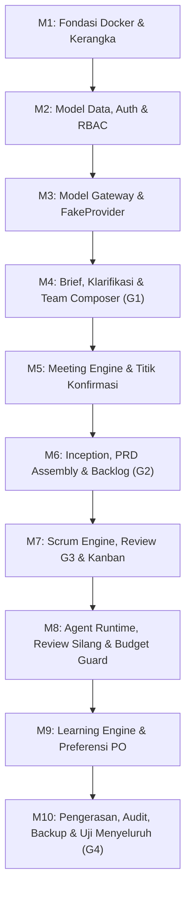

# SDLC Fase 1: Perencanaan Proyek & Studi Kelayakan (Planning & Feasibility)

---

## 1. Visi Proyek & Latar Belakang

Platform **TimAI** dirancang untuk mentransformasi cara manusia berkolaborasi dengan model bahasa besar (LLM). Saat ini, interaksi dengan LLM umumnya bersifat satu-lawan-satu (*chat-based*), rentan terhadap halusinasi, tidak memiliki struktur kendali mutu, dan tidak efisien dalam pemanfaatan anggaran.

**Visi TimAI:**
Membangun platform perangkat lunak di mana pengguna manusia berperan sebagai **Product Owner (PO)** yang mengarahkan **tim agen AI otonom spesialis**. Agen-agen ini berkolaborasi dalam kerangka kerja **Scrum** yang terdisiplin, terikat oleh *Definition of Done* (DoD), saling melakukan review silang (*cross-review*), dan diawasi oleh penjaga anggaran (*Budget Guard*).

---

## 2. Rumusan Masalah (Problem Statement)

1. **Halusinasi & Kurangnya Validasi Fakta:** LLM komersial sering menghasilkan sitasi atau data fiktif jika tidak diawasi oleh agen pemeriksa mutu independen.
2. **Ketiadaan Pembagian Peran yang Tegas:** Satu agen serba bisa (*generalist*) cenderung kehilangan fokus pada naskah panjang (proposal hibah, manuskrip ilmiah, kode perangkat lunak).
3. **Biaya Pemanggilan API yang Tidak Terkontrol:** Penggunaan model mutakhir (*flagship/XHigh*) untuk seluruh tugas sederhana menghabiskan anggaran dalam sekejap.
4. **Kehilangan Kendali Manusia (*Loss of Human Control*):** Banyak platform otonom berjalan tanpa konfirmasi manusia hingga menghasilkan luaran yang melenceng jauh dari tujuan awal.

---

## 3. Studi Kelayakan (Kerangka Kerja TELOS)

| Dimensi Kelayakan | Analisis & Bukti Kelayakan pada TimAI | Status |
|---|---|---|
| **Technical (Teknis)** | Memanfaatkan arsitektur *microservices/modular* dengan FastAPI (asynchronous I/O), Redis untuk *pub/sub message queue*, PostgreSQL 16 + pgvector untuk relasional dan pencarian semantik, serta Next.js 14 untuk UI responsif. Adapter LLM seragam mendukung FakeProvider, OpenAI, Anthropic, Gemini, dan Ollama lokal. | **Sangat Layak** |
| **Economic (Ekonomi)** | Model tiering (Low, Med, High, XHigh) mengalokasikan tugas murah ke model hemat (hemat biaya hingga 65% dibanding menggunakan Claude Sonnet / GPT-4o untuk semua agen). Budget Guard mengunci biaya dengan ambang peringatan 50%, 80%, dan jeda otomatis 100%. | **Sangat Layak** |
| **Legal & Ethical (Hukum & Etika)** | Prinsip Kejujuran (FR-14): Sistem tidak melatih bobot model pihak ketiga tanpa izin. Enkripsi AES-256-GCM menjaga kerahasiaan kunci API. Flag `is_secret=True` menjamin isolasi memori dan hak cipta kekayaan intelektual (paten/naskah). | **Layak Penuh** |
| **Operational (Operasional)** | Antarmuka web modern dengan alur Scrum yang jelas (Papan Kanban 7 kolom, Ruang Tim, Kotak Konfirmasi). PO tidak perlu menguasai prompt engineering rumit; agen dipandu oleh 25 templat peran bawaan. | **Sangat Layak** |
| **Schedule (Jadwal)** | Pembangunan MVP dibagi menjadi 10 Milestone berurutan yang dapat diverifikasi secara mandiri menggunakan FakeProvider dalam siklus 2 minggu. | **Terpenuhi** |

---

## 4. Ruang Lingkup Proyek (Project Scope)

### Dalam Cakupan (In-Scope MVP v1.0):
- Kerangka kerja kontainerisasi penuh dengan Docker Compose.
- Sistem autentikasi berbasis Argon2 dengan pemisahan hak akses (RBAC: Admin, PO, Viewer).
- Model Gateway terenkripsi AES-256-GCM dengan dukungan FakeProvider dan adapter penyedia utama.
- Formulir intake brief cerdas dengan ekstraksi berkas pendukung (PDF, DOCX, CSV, BibTeX).
- Wawancara klarifikasi agen Analis dan rekomendasi tim agen otomatis (Team Composer).
- Meeting Engine satu putaran (K5) berplafon token dengan sintesis Scrum Master dan Titik Konfirmasi PO.
- Inception Engine berbasis profil (Proposal, Jurnal, Buku, Software, IoT) dengan dokumen Inception, DoD, Epik, dan Product Backlog.
- Scrum Engine & Papan Kanban 7 kolom dengan Sprint Planning, Daily Standup, Sprint Review (G3), dan Retrospektif.
- Agent Runtime dengan hak akses minimal (*least privilege*), review silang otomatis, dan Budget Guard.
- Learning Engine dasar untuk memori preferensi PO dan pencatatan ModelScorecard.
- Penutupan proyek Gerbang G4 dengan paket hasil akhir ZIP dan laporan penutupan resmi.
- Utilitas pencadangan dan pemulihan data (`scripts/backup.py` dan `scripts/restore.py`).

### Di Luar Cakupan (Out-of-Scope MVP - Direncanakan untuk v1.1 & v1.2):
- Runtime eksekusi kode terisolasi (sandbox gVisor/Firecracker) untuk kompilasi firmware IoT/Software (v1.1).
- Fine-tuning bobot model kustom (v1.2).
- Penagihan multi-tenant dan gateway pembayaran publik (v2.0).

---

## 5. Rencana Kerja & Work Breakdown Structure (WBS)

Proyek diselesaikan melalui 10 Milestone terstruktur:

---

## 6. Analisis Risiko & Mitigasi (Risk Assessment Matrix)

| Risiko Teridentifikasi | Tingkat Risiko | Dampak | Rencana Mitigasi |
|---|---|---|---|
| **Kuota API penyedia habis di tengah sprint** | Sedang | Eksekusi agen terhenti | Fallback model otomatis di ModelGateway; notifikasi di UI; pause status tanpa kehilangan state. |
| **Agen berhalusinasi mengklaim rujukan fiktif** | Tinggi | Penolakan proposal/jurnal oleh reviewer manusia | Quality Checker memverifikasi format sitasi & DOI; memberi tag `[perlu sumber]` pada klaim tanpa data. |
| **Kebocoran Kunci API pihak ketiga** | Kritis | Kerugian finansial penyalahgunaan API | Enkripsi AES-256-GCM di DB; masker otomatis `sk-***1234` di API response; audit keamanan otomatis di CI. |
| **Worker crash di tengah diskusi rapat** | Rendah | State hilang / kontribusi ganda | Aturan K5 satu putaran persisten di Postgres; query DB memastikan agen hanya bicara 1 kali per putaran. |
| **Biaya melampaui kemampuan bayar pengguna** | Tinggi | Tagihan membengkak tak terduga | Budget Guard memberlakukan jeda otomatis 100% pagu hingga disetujui PO secara eksplisit. |

---

## 7. Matriks Pemangku Kepentingan (Stakeholders)

- **Product Owner (PO):** Penentu arah, pemilik anggaran, pemberi persetujuan pada seluruh Gerbang (G1, G2, G3, G4).
- **Administrator Sistem:** Pengelola kredensial penyedia model LLM, audit pengguna, dan kebijakan sistem.
- **Viewer / Stakeholder Pasif:** Anggota tim peninjau dengan akses baca-saja (*read-only*) untuk transparansi.
- **Tim Agen AI:** Pekerja otonom terikat peran (Scrum Master, Research Lead, Writers, Editors, Reviewers).
