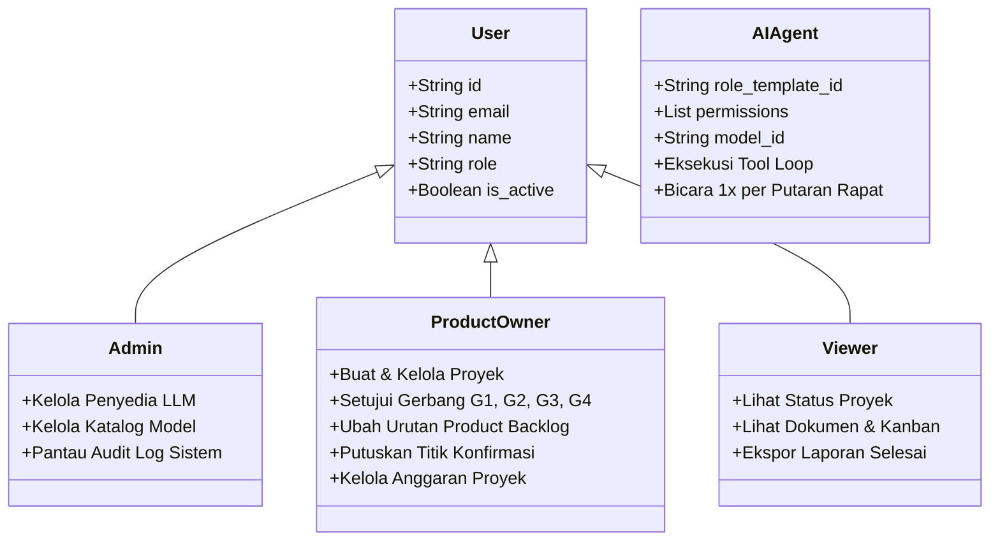

# SDLC Fase 2: Analisis Kebutuhan Perangkat Lunak (Requirements Specification / SRS)

Dokumen Spesifikasi Kebutuhan Perangkat Lunak (*Software Requirements Specification* - SRS) ini menjabarkan seluruh kebutuhan fungsional dan non-fungsional sistem TimAI berdasarkan PRD TimAI Scrum v1.0.

---

## 1. Persona Pengguna & Peran Sistem

Sistem mendukung tiga peran pengguna manusia berbasis RBAC (*Role-Based Access Control*) dan satu kelas agen virtual:

---

## 2. Kebutuhan Fungsional (Functional Requirements - FR)

### FR-1: Intake Brief & Ekstraksi Lampiran
- **FR-1.1:** Pengguna dapat membuat proyek dengan memilih 1 dari 5 profil: `proposal`, `jurnal`, `buku`, `software`, `iot`.
- **FR-1.2:** Pengguna dapat mengunggah berkas pendukung dalam format `.pdf`, `.docx`, `.csv`, `.bib`, `.ris`, `.txt`, `.md` dengan batas ukuran maksimal 50 MB.
- **FR-1.3:** Sistem secara otomatis mengekstrak teks lengkap dan menghasilkan ringkasan intisari lampiran ke database.

### FR-2: Sesi Klarifikasi Otomatis
- **FR-2.1:** Agen Analis mengajukan pertanyaan klarifikasi jika brief ambigu (maksimal 7 pertanyaan terfokus).
- **FR-2.2:** PO dapat menjawab sebagian pertanyaan, melompati (*skip*), atau membiarkan sistem menggunakan asumsi default yang dicatat eksplisit pada `00-brief/klarifikasi.md`.

### FR-3: Katalog Peran Spesialis & Template Profil
- **FR-3.1:** Sistem menyediakan 25 RoleTemplate baku yang mencakup peran manajerial, penulisan, rekayasa, dan review independen.
- **FR-3.2:** Setiap RoleTemplate memiliki konfigurasi versi, kompetensi, tier minimum, izin alat (*tools*), instruksi prompt sistem, dan DoD peran.

### FR-4: Team Composer & Estimasi Dinamis
- **FR-4.1:** Algoritma Team Composer menganalisis brief dan merekomendasikan tim agen yang seimbang (memiliki penulis, editor, dan minimal satu reviewer independen).
- **FR-4.2:** Mengubah tier atau model agen di UI secara instan memperbarui rentang estimasi biaya (IDR/USD) dan estimasi durasi waktu.

### FR-5: Gerbang G1 & Inisialisasi Workspace Git
- **FR-5.1:** Persetujuan Gerbang G1 oleh PO membentuk entitas Agent dan menginisialisasi repositori Git lokal proyek (`workspaces/<project_id>`).
- **FR-5.2:** Sistem menerbitkan piagam tim `01-tim/team-charter.md` lengkap dengan blok metadata PRD 5.2d.

### FR-6: Meeting Engine (Diskusi Satu Putaran K5 & Titik Konfirmasi)
- **FR-6.1:** Diskusi mematuhi aturan K5: Tepat satu kontribusi per peserta per putaran (maksimal 400 kata). Tidak ada putaran kedua tanpa intervensi PO.
- **FR-6.2:** Plafon token putaran menghentikan diskusi seketika jika konsumsi token melebihi batas yang ditentukan.
- **FR-6.3:** Scrum Master menyintesis hasil rapat dan mengajukan Titik Konfirmasi (Opsi A vs Opsi B) kepada PO.
- **FR-6.4:** Keputusan PO dicatat ke database dan file `01-tim/decision-log.md` serta `notulen/agenda-NN.md`.

### FR-7: Inception Engine & Dokumen Rencana
- **FR-7.1:** Menjalankan agenda Inception sesuai profil proyek (misal: 5 agenda untuk Proposal Penelitian).
- **FR-7.2:** Menyusun otomatis dokumen `02-inception/dokumen-inception.md`, Product Goal, Epik, Product Backlog Items ber-story points, DoD (`dod.md`), Rencana Rilis (`rencana-rilis.md`), dan Risk Register (`risiko.md`).
- **FR-7.3:** Gerbang G2 mensyaratkan persetujuan eksplisit PO sebelum proyek dapat melangkah ke tahap Sprint.

### FR-8: Prioritas Product Backlog (Hak Eksklusif PO)
- **FR-8.1:** Hanya pengguna dengan peran PO yang berhak mengubah urutan prioritas item di Product Backlog (`po_sort_order`). Agen AI dilarang mengubah urutan tanpa persetujuan PO.

### FR-9: Scrum Engine, Eksekusi Agen & Review Silang
- **FR-9.1:** Sprint Planning memecah PBI teratas menjadi Task ber-DoD dan mengunci Sprint Goal (`sprint-NN/sprint-plan.md`).
- **FR-9.2:** Laporan Daily Standup dirangkum harian oleh Scrum Master (`sprint-NN/daily/YYYY-MM-DD.md`).
- **FR-9.3:** Tool Loop agen menegakkan izin akses minimal (*least privilege*); agen reviewer dilarang menulis naskah draf.
- **FR-9.4:** Quality Checker memverifikasi batasan kata dan validitas rujukan DOI; klaim tanpa sitasi dilabeli `[perlu sumber]`.
- **FR-9.5:** Review silang wajib oleh Reviewer independen. Jika draf belum memenuhi syarat, dilakukan maksimal 1 kali revisi otomatis sebelum kartu dipindahkan ke status *Waiting PO*.
- **FR-9.6:** Budget Guard mengawasi biaya token secara real-time. Peringatan diberikan pada 50% dan 80%, serta jeda otomatis (*pause*) pada 100% pagu hingga PO menyetujui penambahan.
- **FR-9.7:** Tindakan berisiko tinggi (penghapusan berkas, akses domain baru) wajib memperoleh persetujuan eksplisit PO.

### FR-10: Papan Kanban & Observabilitas Real-time
- **FR-10.1:** Papan Kanban interaktif dengan 7 kolom: *Product Backlog*, *Sprint Backlog*, *In Progress*, *Reviewing*, *Waiting PO*, *Done*, *Rejected*.
- **FR-10.2:** Panel "Agen Sekarang" menampilkan visual status agen (Idle, Berpikir, Menulis, Mereviu) secara real-time beserta gauge pemakaian anggaran.

### FR-11: Gerbang G3 (Sprint Review) & Retrospektif
- **FR-11.1:** PO meninjau tiap PBI pada Gerbang G3. PBI yang diterima berstatus `done` dan menambah angka *velocity*.
- **FR-11.2:** PBI yang ditolak dikembalikan secara aman ke Product Backlog untuk disempurnakan pada sprint berikutnya.
- **FR-11.3:** Retrospektif menghasilkan usulan pelajaran baru (*Lesson*) yang disimpan dengan status `suggested`.

### FR-12: Gerbang G4 (Penutupan Proyek)
- **FR-12.1:** PO menyetujui penutupan proyek di Gerbang G4.
- **FR-12.2:** Sistem menghasilkan `final/laporan-penutupan.md` (dan ekspor PDF/DOCX), paket arsip `final/paket-hasil-akhir.zip`, dan tag rilis Git `final-release`.

### FR-13: Ekspor Dokumen
- **FR-13.1:** Dokumen Inception dan Laporan Penutupan dapat diekspor secara dinamis ke format `.docx` dan `.pdf` dengan tata letak profesional.

### FR-14: Learning Engine (Continuous System Learning)
- **FR-14.1:** Pembelajaran berlandaskan Prinsip Kejujuran (sistem tidak melatih bobot model pihak ketiga; pembelajaran terjadi di tingkat sistem).
- **FR-14.2:** Preferensi PO diekstrak dari Titik Konfirmasi dan alasan penolakan di Sprint Review G3.
- **FR-14.3:** Lesson berstatus `suggested` -> `active` (setelah disetujui PO atau muncul berulang >= 2 kali) -> `inactive`.
- **FR-14.4:** Lesson aktif disuntikkan ke prompt agen terkait. Proyek rahasia (`is_secret=True`) terisolasi pada lingkup proyek.
- **FR-14.5:** ModelScorecard mencatat tingkat penerimaan dan biaya per model/peran untuk mengkalibrasi rekomendasi Team Composer.

---

## 3. Kebutuhan Non-Fungsional (Non-Functional Requirements - NFR)

| ID | Parameter | Spesifikasi & Tolok Ukur |
|---|---|---|
| **NFR-1** | **Kinerja & Responsivitas** | Endpoint API stateless merespons dalam < 200 ms (p95); pemanggilan LLM dialirkan via Server-Sent Events (SSE). |
| **NFR-2** | **Keamanan & Kriptografi** | Kata sandi di-hash menggunakan Argon2id; Kunci API pihak ketiga disimpan terenkripsi menggunakan AES-256-GCM; Token JWT berumur 8 jam; Sanitasi unggahan berkas mencegah *path traversal* (`../`). |
| **NFR-3** | **Keandalan & Ketahanan Crash** | Kondisi diskusi dan sprint tersimpan persisten di basis data ACID PostgreSQL; Restart container worker tidak menyebabkan kontribusi ganda agen atau hilangnya status kartu kanban. |
| **NFR-4** | **Observabilitas** | Endpoint `/health` memantau konektivitas DB dan Redis secara real-time; seluruh pemanggilan model mencatat latensi, input token, output token, dan estimasi biaya ke tabel `usage_records`. |
| **NFR-5** | **Aksesibilitas & Usabilitas** | Antarmuka pengguna bilingual (Bahasa Indonesia & English) dengan dukungan tema Gelap/Terang (*Dark/Light mode*). |
