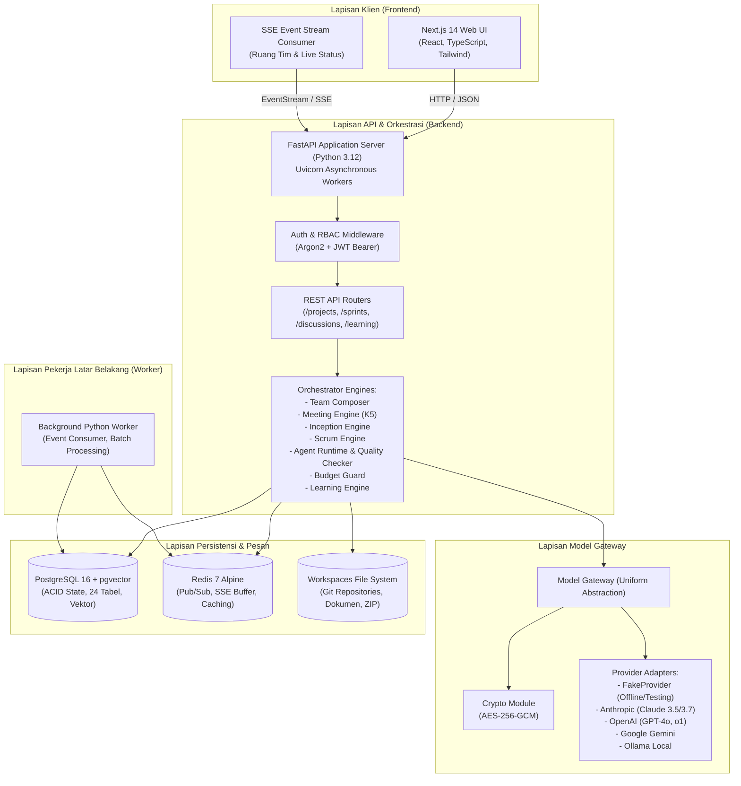
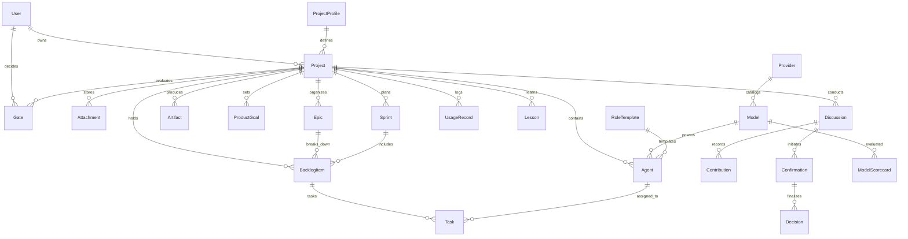
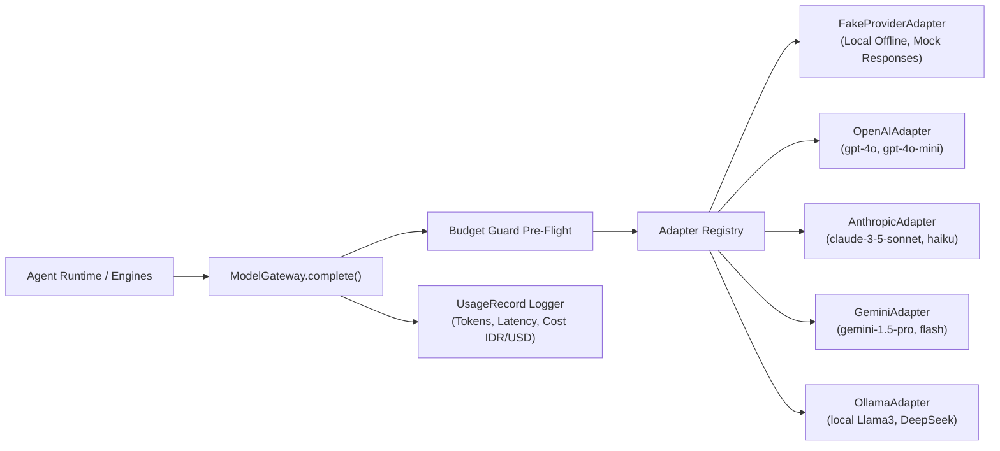
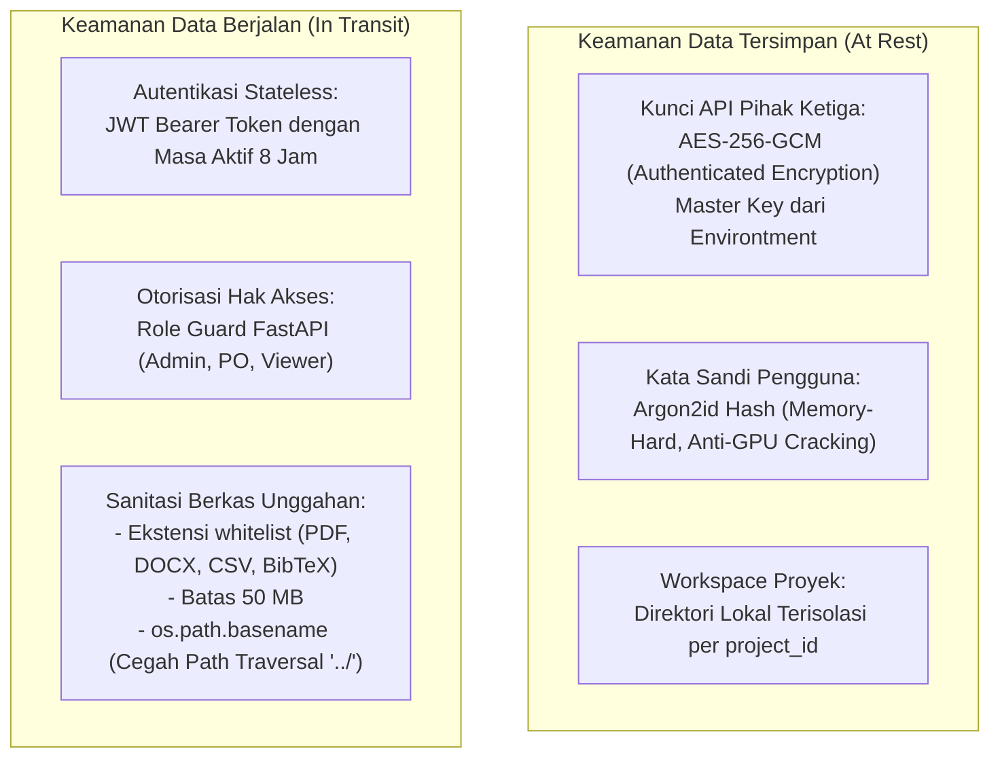

# SDLC Fase 3: Desain Arsitektur Sistem & Spesifikasi Teknis (System Design & Architecture)

Dokumen ini menjelaskan arsitektur tingkat tinggi (*High-Level Design* - HLD) dan desain terperinci (*Low-Level Design* - LLD) platform TimAI.

---

## 1. Arsitektur Tingkat Tinggi (High-Level Architecture)

Platform TimAI mengadopsi arsitektur *Modular Layered Monolith* dengan kontainerisasi Docker:

---

## 2. Desain Basis Data Relasional (ERD & 24 Entitas)

Basis data PostgreSQL dirancang dengan normalisasi tingkat 3 (3NF) dan integritas referensial penuh:

### Rincian 24 Tabel Utama:
1. `users`: Akun pengguna dengan password hash Argon2id dan peran RBAC (`admin`, `po`, `viewer`).
2. `project_profiles`: Definisi 5 profil baku (`proposal`, `jurnal`, `buku`, `software`, `iot`) beserta default agenda & DoD.
3. `projects`: Data proyek (judul, brief, anggaran, mata uang, bahasa, status, dan flag `is_secret`).
4. `attachments`: Lampiran berkas (PDF, DOCX, CSV, BibTeX) dan intisari hasil ekstraksi teks.
5. `role_templates`: Definisi 25 peran spesialis (nama, kompetensi, tier minimum, izin alat, prompt, DoD).
6. `providers`: Kredensial penyedia model LLM (kunci API tersimpan terenkripsi dengan AES-256-GCM).
7. `models`: Katalog model AI (tier, harga input/output per 1M token, skor kompetensi, status aktif).
8. `agents`: Instansiasi agen virtual untuk proyek tertentu, terikat ke RoleTemplate dan Model.
9. `discussions`: Sesi rapat terstruktur (tipe: `general`, `inception`, `standup`, `review`, `retro`).
10. `contributions`: Kontribusi pesan agen pada putaran rapat (K5: 1 pesan per peserta per putaran).
11. `confirmations`: Titik Konfirmasi Scrum Master untuk persetujuan PO (Opsi A vs Opsi B).
12. `decisions`: Catatan keputusan resmi PO yang mengikat arah tim.
13. `artifacts`: Berkas keluaran bernilai (dokumen Inception, laporan sprint, paket naskah).
14. `product_goals`: Sasaran utama produk proyek.
15. `epics`: Kelompok fitur besar proyek.
16. `backlog_items`: Product Backlog Items (PBI) ber-story points, acceptance criteria, dan urutan PO (`po_sort_order`).
17. `sprints`: Siklus sprint (nomor sprint, sprint goal, budget limit, status, velocity tercapai).
18. `tasks`: Tugas kerja turunan PBI (langkah `execute` untuk writer, langkah `verify` untuk reviewer).
19. `increments`: Kumpulan deliverable yang disetujui pada akhir sprint.
20. `gates`: Catatan keputusan pada gerbang strategis (`G1`, `G2`, `G3`, `G4`).
21. `usage_records`: Pencatatan konsumsi token dan biaya tiap pemanggilan model AI.
22. `lessons`: Pengetahuan preferensi PO dan pelajaran retro (`suggested` -> `active` -> `inactive`).
23. `model_scorecards`: Rekam jejak rasio keberhasilan dan biaya model per peran dan profil.
24. `example_libraries`: Pustaka contoh acuan berkualitas tinggi.

---

## 3. Arsitektur Model Gateway & Abstraksi Penyedia

Untuk mencegah *vendor lock-in* dan mengoptimalkan biaya, seluruh pemanggilan LLM dialihkan melalui `ModelGateway`:

### Mekanisme Kunci:
1. **Fallback Model Otomatis:** Jika model primer mengalami *rate-limit* atau error jaringan, gateway otomatis mencoba *fallback model* yang telah ditentukan pada profil peran.
2. **Kalkulasi Biaya Real-time:** Setiap respons mencatat token input dan output serta menghitung biaya dalam mata uang proyek (USD atau IDR).
3. **Penyembunyian Kredensial:** Kunci API didekripsi hanya di dalam memori saat pemanggilan HTTP keluar, dan tidak pernah dicetak di log aplikasi.

---

## 4. Arsitektur Keamanan & Kriptografi

---

## 5. Mesin Orkestrasi Agen (Agent Runtime & Scrum Flow)

1. **Prinsip Izin Minimal (*Least Privilege*):** Agen hanya dapat mengeksekusi alat (*tools*) yang terdaftar pada `permissions` perannya:
   - Agen Penulis (*Writer*): `write_workspace_file`, `search_literature`, `post_message_to_team_room`.
   - Agen Peninjau (*Reviewer*): `read_workspace_file`, `review_card`, `post_message_to_team_room` (DILARANG menulis berkas draf kerja).
2. **Review Silang Wajib & Siklus Revisi Maksimal 1x (FR-9.5):**
   - Agen Penulis menyusun draf deliverable.
   - Quality Checker memvalidasi batas kata dan sitasi DOI.
   - Agen Peninjau memberikan penilaian (*Approved* atau *Needs Revision*).
   - Jika *Needs Revision*, sistem melakukan maksimal 1 revisi otomatis. Jika masih belum sesuai, kartu berpindah ke *Waiting PO* agar PO memberikan arahan.
3. **Penjaga Anggaran (*Budget Guard*):**
   - Ambang 50%: Peringatan visual di UI.
   - Ambang 80%: Notifikasi peringatan kritis.
   - Ambang 100%: Jeda otomatis (*pause*) eksekusi agen. Proyek tidak dapat dieksekusi lebih lanjut hingga PO menyetujui penambahan pagu anggaran.
