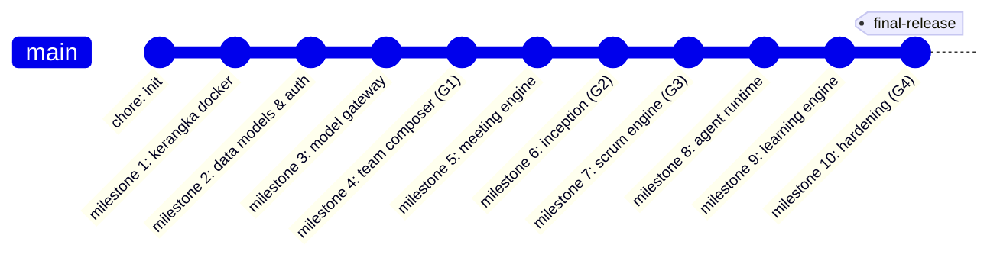

# SDLC Fase 4: Panduan Implementasi & Pengembangan (Implementation & Development)

Dokumen ini memuat panduan implementasi teknis, struktur repositori, standar penulisan kode, dan alur kerja Git untuk pengembang platform TimAI.

---

## 1. Matriks Tumpukan Teknologi (Tech Stack Matrix)

| Komponen | Teknologi | Versi | Peran & Justifikasi |
|---|---|---|---|
| **Bahasa Backend** | Python | 3.12+ | Ekosistem AI/ML terbaik, dukungan asynchronous I/O modern |
| **Framework Web** | FastAPI | 0.115+ | Performa tinggi, OpenAPI schema terintegrasi, validasi Pydantic |
| **ORM / Basis Data** | SQLAlchemy (Asyncio) | 2.0+ | Pemetaan objek relasional asinkron aman dari injeksi SQL |
| **Migrasi Skema** | Alembic | 1.14+ | Kontrol versi terstruktur untuk skema database |
| **Basis Data Relasional** | PostgreSQL | 16-Alpine | ACID compliant, dukungan ekstensi `pgvector` |
| **Cache & PubSub** | Redis | 7-Alpine | Antrian pesan latar belakang, buffer Server-Sent Events (SSE) |
| **Framework Frontend** | Next.js | 14.2+ | React Server Components, SSR/SSG, performa tinggi |
| **Styling & Ikon** | Tailwind CSS + Lucide | 3.4+ / 0.453+ | Utilitas CSS modern dan ikon antarmuka terstandar |
| **Linter & Formatter** | Ruff (Backend) / ESLint (Frontend) | 0.8+ / 8.57+ | Penegakan standar gaya kode otomatis yang sangat cepat |
| **Pengujian** | Pytest + pytest-asyncio | 8.3+ / 0.24+ | Rangkaian pengujian terotomatisasi untuk logika async |

---

## 2. Struktur Direktori Proyek

```
timai/
├── .agents/rules/timai.md         # Aturan dan batasan instruksi agen Antigravity
├── .github/workflows/ci.yml       # Konfigurasi pipeline CI/CD GitHub Actions
├── backend/
│   ├── alembic/                   # Skrip migrasi skema database
│   ├── app/
│   │   ├── api/                   # Endpoint REST API (auth, projects, sprints, dll)
│   │   ├── core/                  # Konfigurasi, crypto AES, auth JWT/Argon2
│   │   ├── db/                    # Model SQLAlchemy (models.py) & koneksi session
│   │   ├── gateway/               # ModelGateway & adapter penyedia LLM
│   │   ├── orchestrator/          # Engine logika Scrum, Inception, Runtime, Learning
│   │   └── schemas/               # Skema Pydantic v2 untuk DTO request/response
│   └── tests/                     # 11 berkas pengujian Pytest (34 skenario)
├── frontend/
│   ├── src/
│   │   ├── app/                   # Next.js 14 App Router (halaman utama, layout)
│   │   └── components/            # Komponen UI modular (Kanban, ActiveAgents, dll)
│   └── test.js                    # Pengujian integritas antarmuka & kamus i18n
├── docs/
│   ├── sdlc/                      # Dokumentasi 7 fase SDLC (dokumen ini)
│   ├── CHECKLIST.md               # Pelacak kemajuan 10 milestone MVP
│   ├── PILOT_CHECKLIST.md         # Panduan persiapan PO sebelum proyek nyata
│   ├── PRD_TimAI_Scrum.md         # Product Requirement Document acuan utama
│   └── STATUS.md                  # Riwayat status dan capaian per milestone
├── scripts/
│   ├── backup.py                  # Utilitas pencadangan otomatis DB & Workspaces
│   └── restore.py                 # Utilitas pemulihan sistem dari arsip ZIP
├── workspaces/                    # Direktori penyimpanan repositori Git lokal proyek
├── docker-compose.yml             # Orkestrasi 5 container utama
├── Makefile                       # Pintasan perintah pengembang (up, down, test, lint)
└── README.md                      # Panduan instalasi dan dokumentasi utama
```

---

## 3. Standar Penulisan Kode (Coding Guidelines)

### Konvensi Backend (Python):
1. **Asynchronous by Default:** Seluruh operasi I/O (basis data, HTTP keluar, pemanggilan LLM) wajib menggunakan `async`/`await`.
2. **Type Annotations Ketat:** Setiap fungsi wajib menyertakan anotasi tipe argumen dan *return type* (misal: `def func(db: AsyncSession) -> dict[str, Any]:`).
3. **Pemberlakuan Linter Ruff:**
   - Panjang baris maksimal: 120 karakter.
   - Aturan linter: `E` (Pycodestyle Errors), `F` (Pyflakes), `I` (isort / import sorting).
4. **Pencegahan Kebocoran Kredensial:**
   - Dilarang keras melakukan *hardcoding* API key atau kata sandi di dalam berkas kode sumber. Seluruh kredensial wajib dibaca dari *environment variables* atau didekripsi melalui modul `crypto.py`.

### Konvensi Frontend (Next.js / TypeScript):
1. **Pemisahan Komponen Modular:** Halaman utama (`page.tsx`) hanya bertindak sebagai orkestrator tampilan. Komponen kompleks (seperti Papan Kanban, Panel Agen Sekarang, Panel Pembelajaran) diisolasi ke dalam berkas terpisah di bawah `src/components/`.
2. **Dukungan Dwibahasa (i18n):** Teks antarmuka dilarang ditulis langsung (*hardcoded*). Seluruh teks harus merujuk ke kamus terjemahan `idTranslations` (Bahasa Indonesia) atau `enTranslations` (English).
3. **Penanganan Status Responsif:** Komponen interaktif wajib memiliki indikator status visual (indikator loading, badge status, disabled state saat proses berlangsung).

---

## 4. Alur Kerja Git & Strategi Percabangan (Git Workflow)

TimAI menggunakan strategi *Trunk-Based Development* yang disesuaikan dengan gerbang verifikasi:



### Aturan Format Pesan Commit:
- Untuk milestone fitur terstruktur: `milestone N: <judul deskriptif>`
- Untuk perbaikan atau pemeliharaan: `feat:`, `fix:`, `docs:`, `chore:`, `refactor:`

### Perlindungan Berkas Rahasia (.gitignore):
Direktori berikut wajib diabaikan oleh Git untuk mencegah kebocoran data:
- `.env`, `.env.local`, `*.env`
- `workspaces/` (tempat penyimpanan naskah privat dan data proyek pengguna)
- `backups/` (arsip dump database dan berkas pemulihan)
- `pgdata/` dan `redisdata/` (volume data lokal Docker)
