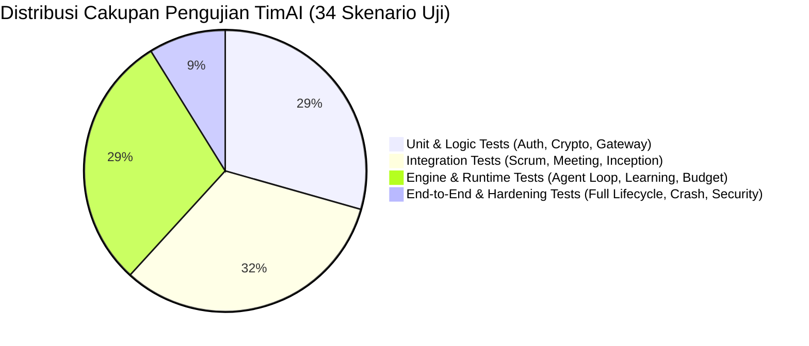

# SDLC Fase 5: Pengujian & Penjaminan Mutu (Testing & Quality Assurance)

Dokumen ini memuat Rencana Pengujian Perangkat Lunak (*Software Test Plan* - STP) dan Laporan Hasil Uji (*Software Test Report* - STR) untuk platform TimAI.

---

## 1. Strategi & Piramida Pengujian (Testing Strategy)

Pengujian TimAI dirancang mengikuti piramida pengujian modern dengan pendekatan otomasi penuh:



### Prinsip Utama Pengujian:
1. **Pengujian Mandiri Tanpa Biaya (FakeProvider):** Seluruh pengujian otomatis dijalankan menggunakan `FakeProviderAdapter` sehingga bebas biaya pemanggilan API komersial, deterministik, dan dapat dijalankan secara luring (*offline*).
2. **Basis Data Pengujian Terisolasi:** Pengujian menggunakan SQLite *in-memory* asinkron (`sqlite+aiosqlite:///:memory:`) yang dibersihkan sebelum tiap fungsi tes dijalankan (`setup_test_db`).
3. **Verifikasi Ketahanan Bencana (*Fault Tolerance*):** Pengujian menyimulasikan interupsi atau kegagalan worker di tengah jalan untuk membuktikan integritas status rapat dan kartu kanban.

---

## 2. Matriks Rincian Kasus Uji (Test Case Matrix - 34 Skenario)

| Berkas Uji | Jumlah Tes | Fokus & Kriteria Verifikasi | Status |
|---|:---:|---|:---:|
| `tests/test_agent_runtime.py` | 7 | Penegakan *least privilege*, perlindungan aksi berisiko, ambang pagu anggaran (50%, 80%, 100% pause), review silang wajib, batas maksimal 1x auto-revisi, dan eksekusi proposal end-to-end. | **PASSED** |
| `tests/test_api.py` | 3 | Validasi endpoint FastAPI `/health`, `/version`, serta endpoint manajemen dasar. | **PASSED** |
| `tests/test_auth_and_rbac.py` | 2 | Hashing kata sandi Argon2id, pembuatan token JWT, dan pemisahan hak akses peran (Admin, PO, Viewer). | **PASSED** |
| `tests/test_e2e_and_hardening.py` | 3 | Alur lengkap E2E (Brief -> G1 -> Inception G2 -> Sprints G3 -> Closure G4), uji ketahanan worker crash & pemulihan interupsi K5, dan audit keamanan (masking kunci API, RBAC, validasi upload). | **PASSED** |
| `tests/test_inception.py` | 2 | Inisialisasi 5 agenda Inception, sintesis rapat, perakitan `dokumen-inception.md`, pembuatan Epik/PBI/DoD, dan penegakan hak eksklusif PO untuk pengurutan backlog. | **PASSED** |
| `tests/test_learning_engine.py` | 5 | Siklus hidup Lesson (usulan -> aktif -> nonaktif), promosi otomatis (kemunculan >= 2x), injeksi pelajaran aktif ke prompt, pencatatan ModelScorecard, dan isolasi memori proyek rahasia. | **PASSED** |
| `tests/test_meeting_engine.py` | 3 | Penegakan aturan satu putaran K5 (1 pesan/agen/putaran), batas 400 kata, plafon token penghenti putaran, dan Titik Konfirmasi Scrum Master (Opsi A/B). | **PASSED** |
| `tests/test_migration.py` | 1 | Eksekusi migrasi skema Alembic maju (*upgrade head*) dan mundur (*downgrade base*) secara bersih, serta seeding 5 profil proyek. | **PASSED** |
| `tests/test_model_gateway.py` | 5 | Antarmuka seragam ModelGateway, enkripsi/dekripsi AES-256-GCM, fallback model otomatis saat error, dan pencatatan token/biaya ke `usage_records`. | **PASSED** |
| `tests/test_scrum_engine.py` | 1 | Siklus Sprint lengkap (Planning -> Eksekusi -> Review G3 -> Retro), penolakan PBI yang dikembalikan ke Product Backlog, serta kalkulasi Burndown dan Velocity. | **PASSED** |
| `tests/test_team_composer.py` | 2 | Analisis brief, rekomendasi komposisi tim agen dari 25 katalog peran, perhitungan dinamis estimasi biaya/waktu, dan persetujuan Gerbang G1 penerbit `team-charter.md`. | **PASSED** |
| `frontend/test.js` | 1 | Integritas kamus terjemahan dwibahasa (ID/EN) dan kelengkapan teks UI. | **PASSED** |

---

## 3. Laporan Hasil Pengujian Terakhir (Execution Report)

```
============================= test session starts ==============================
platform linux -- Python 3.12.16, pytest-9.1.1, pluggy-1.7.0
rootdir: /app
configfile: pytest.ini
plugins: anyio-4.15.1, asyncio-1.4.1
collected 34 items

tests/test_agent_runtime.py .......                                      [ 20%]
tests/test_api.py ...                                                    [ 29%]
tests/test_auth_and_rbac.py ..                                           [ 35%]
tests/test_e2e_and_hardening.py ...                                      [ 44%]
tests/test_inception.py ..                                               [ 50%]
tests/test_learning_engine.py .....                                      [ 64%]
tests/test_meeting_engine.py ...                                         [ 73%]
tests/test_migration.py .                                                [ 76%]
tests/test_model_gateway.py .....                                        [ 91%]
tests/test_scrum_engine.py .                                             [ 94%]
tests/test_team_composer.py ..                                           [100%]

======================= 34 passed, 6 warnings in 17.18s ========================
```

### Hasil Pemeriksaan Mutu Statis (Static Code Analysis):
- **Backend Linting (Ruff):** `All checks passed!` (0 error, 0 warning pemblokir).
- **Frontend Build (Next.js):** `Compiled successfully! Generating static pages (4/4) - 0 errors`.

---

## 4. Penanganan Kasus Uji Ekstrem (Edge Cases & Resilience)

1. **Uji Worker Terbunuh di Tengah Rapat:**
   - Skenario: Satu agen telah berbicara, kemudian proses worker mati mendadak sebelum notulen dirangkum.
   - Hasil Uji: Saat worker dihidupkan kembali, sistem mendeteksi kontribusi agen yang sudah tersimpan di database dan tidak menduplikasi pesan agen tersebut. Rapat selesai dengan tepat satu kontribusi per peserta.
2. **Uji Serangan Path Traversal pada Unggahan:**
   - Skenario: Berkas diunggah dengan nama `../../etc/passwd` atau `../../safe_notes.txt`.
   - Hasil Uji: Fungsi sanitasi `os.path.basename` memotong path relatif dan hanya menyimpan `safe_notes.txt` di dalam folder unggahan proyek yang terisolasi.
3. **Uji Unggahan Ekstensi Berbahaya:**
   - Skenario: Pengguna mencoba mengunggah berkas `.exe`, `.bat`, atau `.sh`.
   - Hasil Uji: Ditolak langsung dengan kode respons HTTP `400 Bad Request` dan pesan penjelasan yang informatif.
