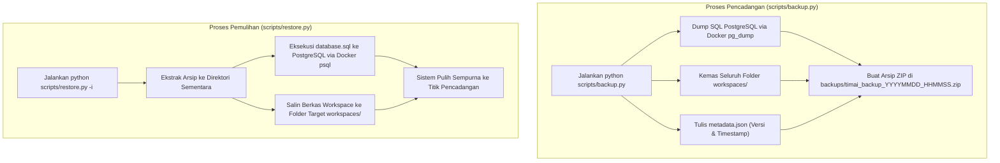

# SDLC Fase 7: Pemeliharaan, Operasional & Pemulihan Bencana (Operations & Maintenance)

Buku panduan operasional (*Operations Runbook*) ini diperuntukkan bagi Site Reliability Engineer (SRE), Administrator Sistem, dan Product Owner untuk memelihara ketersediaan tinggi (*high availability*) platform TimAI.

---

## 1. Pemantauan Kesehatan Sistem & Observabilitas (Monitoring)

### Endpoint Pemantauan Bawaan:
- **Health Check (`GET /health`):**
  Mengembalikan status konektivitas basis data PostgreSQL dan cache Redis:
  ```json
  {
    "status": "ok",
    "database": "connected",
    "redis": "connected"
  }
  ```
  Jika salah satu komponen tidak merespons, status berubah menjadi `"degraded"`.
- **Version & Environment (`GET /version`):**
  Mengembalikan nama aplikasi, versi rilis, dan profil lingkungan (`development`/`production`).

### Tingkat Logging (Logging Levels):
Log terstruktur dicetak dengan format standar Python `logging`:
- `INFO`: Alur normal (pembentukan tim, awal sprint, pergantian kartu kanban).
- `WARNING`: Ambang batas anggaran tercapai (50% dan 80%), atau upaya akses alat tanpa izin yang berhasil dicegah.
- `ERROR`: Pemanggilan API LLM gagal (memicu fallback otomatis), atau error query basis data.

---

## 2. Rencana Pemulihan Bencana (Disaster Recovery & Backup/Restore)

TimAI dilengkapi dengan utilitas pencadangan terpadu yang membungkus basis data relasional PostgreSQL dan berkas naskah Git ke dalam satu arsip ZIP terkompresi.



### Prosedur Rutin Pencadangan:
```bash
# Menjalankan backup penuh
python scripts/backup.py

# Menjalankan backup hanya database
python scripts/backup.py --no-workspaces

# Menjalankan backup hanya berkas workspaces
python scripts/backup.py --no-db
```

### Prosedur Pemulihan (Restore):
```bash
# Memulihkan seluruh sistem dari berkas cadangan
python scripts/restore.py -i backups/timai_backup_20261027_032422.zip
```

> [!TIP]
> Jadwalkan pencadangan otomatis harian (*daily cron*) pada server produksi:
> `0 2 * * * cd /opt/timai && /opt/timai/.venv/bin/python scripts/backup.py >> /var/log/timai_backup.log 2>&1`

---

## 3. Playbook Penanganan Insiden (Troubleshooting Playbook)

### Insiden 1: Layanan Melaporkan Status Degraded (`/health` degraded)
1. **Pemeriksaan Status Kontainer:**
   ```bash
   docker compose ps
   ```
2. **Pemeriksaan Log Layanan:**
   ```bash
   docker compose logs --tail=100 postgres
   docker compose logs --tail=100 redis
   ```
3. **Tindakan Pemulihan:**
   Restart layanan yang gagal: `docker compose restart postgres redis`

---

### Insiden 2: Pagu Anggaran Proyek Mencapai 100% (Status Proyek: Paused)
1. **Gejala:** Agen berhenti mengeksekusi tugas baru; kartu kanban tidak bergerak.
2. **Penyebab:** Penjaga anggaran (*Budget Guard*) menahan eksekusi demi mencegah pembengkakan biaya yang tidak diinginkan PO.
3. **Tindakan Pemulihan:**
   - PO masuk ke antarmuka web proyek.
   - Periksa rincian pemakaian biaya token pada gauge anggaran.
   - Klik tombol **Tambah Pagu Anggaran** (misal: tambah Rp 1.000.000). Status proyek otomatis kembali ke `sprint` dan agen melanjutkan tugas.

---

### Insiden 3: Pemanggilan Model AI Primer Mengalami Timeout / Rate Limit
1. **Gejala:** Log backend menampilkan error `RateLimitError` atau `ServiceUnavailable` dari penyedia LLM (OpenAI/Anthropic).
2. **Mekanisme Otomatis:** `ModelGateway` secara otomatis mengalihkan tugas ke `fallback_model` yang telah dikonfigurasi pada profil tim.
3. **Tindakan Lanjutan:**
   - Masuk sebagai Admin ke menu **Penyedia Model** (`/providers`).
   - Periksa saldo kredit akun penyedia atau sesuaikan batas *RPM/TPM* pada dasbor penyedia bersangkutan.

---

### Insiden 4: Worker Terhenti atau Antrian Menumpuk
1. **Pemeriksaan Antrian Redis:**
   ```bash
   docker compose exec redis redis-cli ping
   ```
2. **Restart Worker Bersih:**
   ```bash
   docker compose restart worker
   ```
   *Karena seluruh status rapat mematuhi aturan K5 dan tersimpan persisten di PostgreSQL, restart worker tidak akan menduplikasi kontribusi agen atau merusak data.*

---

## 4. Pemeliharaan Berkala Basis Data (Housekeeping)

Lakukan pembersihan rutin setiap bulan di server produksi:

```bash
# 1. Analisis dan optimasi tabel PostgreSQL
docker compose exec postgres psql -U postgres -d timai -c "VACUUM ANALYZE;"

# 2. Rotasi log kontainer Docker yang berukuran besar
docker compose down && docker compose up -d
```
